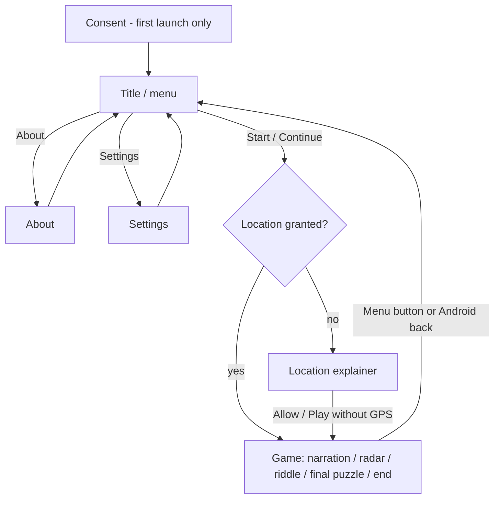

# PRD: Mystère à Bruguières

Status: approved
Project slug: mysteres-bruguieres
Final app name: Mystère à Bruguières
Android package: io.github.nhilaire.mysteresbruguieres
Version target: 0.1.0
Last updated: 2026-10-28 (amended after the phone test: AC-36)

> Written in English. Player-facing text is quoted in the "Player copy" section, in every language of the game
> (`factory-app.json` "languages"; French is the reference).
> Status becomes `approved` only after the user explicitly approves this document.

## Summary

A family treasure hunt played on foot in the centre of Bruguières (Haute-Garonne). Auguste Meridius, a fictional
master clockmaker and "keeper of memory" of the town, tells the story of 9 real places. A GPS + compass radar leads
the family to each place; there, an observation riddle whose answer is in front of them (a plaque, a wall, steps)
gives a number. The 9 numbers feed a final puzzle that reveals the Occitan word GAMOUNA ("ford of the monks").

This version ports an existing, working game (source: a prior Expo project) into the factory. The route content is
kept verbatim; the port adds English, opt-in telemetry with consent, removes the Azure backend and the device
UUID, and improves the feel: a livelier radar, Auguste reactions and screen transitions, and an interactive final
puzzle.

French pitch: « Suis le radar d'Auguste, l'horloger, à travers les rues de Bruguières : observe, résous ses énigmes
et réveille le mot oublié de la ville. »

## Target players

- Families (parents with children), playing together on one phone, outdoors, in Bruguières.
- One adventure lasts about 2 hours on foot or by bike; it can be paused and resumed later (progress is saved).
- Played while walking: big buttons, readable text in daylight, one-hand use, portrait.

## Core loop

1. **Listen**: Auguste tells the next place (typewriter narration, animated portrait); tap to go on.
2. **Walk**: the radar shows direction, distance and proximity (sweep, pulse, haptic ticks) until arrival
   (automatic or "I'm here!").
3. **Observe**: a multiple-choice riddle about something visible on site; a first-try answer scores a point.
4. Repeat for the 9 places, then **solve** the final puzzle with the 9 numbers and see GAMOUNA appear letter by
   letter, then the score and the rating.

What pulls forward: the story (each place reveals a page of Auguste's memory), the radar getting "hot", and the
collected numbers building toward the final word.

## Use cases

| ID | As a player I want to... | So that... |
|---|---|---|
| UC-01 | choose whether to share anonymous statistics on first launch | my privacy is respected |
| UC-02 | start the adventure and understand why the location is needed | I can allow it with confidence |
| UC-03 | be guided to each place by the radar | I find it without a map |
| UC-04 | confirm my arrival by hand, or open my maps app when lost | a bad GPS signal never blocks the game |
| UC-05 | answer the riddle by observing the place | I discover the town, not the phone |
| UC-06 | stop and continue later from where I was | the 2-hour walk can be split |
| UC-07 | go back to re-read previous narration | I do not miss part of the story |
| UC-08 | solve the final puzzle myself | I feel I earned the mystery word |
| UC-09 | see my score and rate the adventure | the end feels like an achievement |
| UC-10 | play in French or English, mute sounds, turn off vibrations | the game fits my family |
| UC-11 | restart the adventure from scratch | another family member can play |
| UC-12 | read why the game was made | I know who made it and why |

## Screens

- **Consent** (first launch only, before anything else): what is collected, Accept / Refuse equally easy. Choice
  changeable in Settings.
- **Title / menu** (ink-and-brass "Auguste's workshop" mood): workshop image, game name, tagline. Never-started
  adventure: one button "Start the adventure". Adventure in progress: progress card (bar, percentage, places
  reached x/9, riddles solved), "Continue", "Restart" (destructive confirmation dialog). Always: "Settings",
  "About". Android back quits the app.
- **Location explainer** (source `PermissionsScreen`, kept): why the position is needed, what is not done (never
  stored nor sent, GPS only on radar screens), cost of refusing; 6 states: `undetermined`, `granted`, `denied`,
  `blocked`, `servicesDisabled`, `error`, each with its action (allow, ask again, open settings, enable location,
  retry) plus "Play without GPS" (remembered for the app session). Re-reads the state when the app comes back to
  the foreground; a newly granted permission goes straight to the game.
- **Game**, routed by the scenario screen type (scenario file, one per language, same structure):
  - `home` / `explanation`: Auguste portrait (talking sprite) + typewriter text; optional background sound
    (church bells on the church narration screen).
  - `radar`: animated radar, distance, cardinal direction, step label "Step n of 9", "I'm here!", "I can't find the
    place". Navigation arrows hidden; Menu button visible.
  - `quiz`: intro, question, 3-6 answer buttons, Auguste reaction portrait.
  - `final_puzzle` (new, replaces the source's multiple-choice final quiz): see Rules.
  - `final`: closing text, score x/9, 1-5 star rating, "Restart the adventure".
  - A "☰ Menu" button is always visible; back/forward arrows on non-radar screens (rules below). Android back
    returns to the title.
- **Settings** (new): language (Automatic / Français / English), sounds on/off, vibrations on/off, statistics
  on/off.
- **About** (« À propos »): the author's story, "how to play" bullets from the source, the "made by a passionate
  independent developer" line, the data statement, the version number.

## Rules and scoring

### Scenario

- The scenario is the source `config/game-scenario.json` (34 screens), French text verbatim, with an English
  translation of the same structure. Screen types and order are identical in both languages; a unit test checks
  that both files have the same types, coordinates, number of choices and answer index.
- French typography: `fr.ts` and `scenario/fr.json` use a no-break space (U+00A0 before `:` and inside « », U+202F
  before `; ! ?`). This is the only change allowed to the otherwise verbatim French scenario.
- The source's last quiz (index 31, multiple choice "Quel mot obtiens-tu ?") becomes a `final_puzzle` screen.
- 9 places, in order: town hall, horse-head house, fountain with steps, media library (the elephant), Square
  Bellevue, church, wash-house, leisure-park perch, chess table (coordinates in the scenario).
- 9 scored riddles; their correct answers, in order, are `2, 9, 8, 21, 17, 5, 4, 7, 100`.

### Narration

- Typewriter at 30 ms per character. Tap while typing shows the whole block; tap after goes to the next block; tap on
  the last block goes to the next screen. `**bold**` is rendered bold.
- Auguste's talking portrait: 5 sprite poses (one per paragraph, cycling), each with 4 mouth frames played in the
  sequence `[1,3,2,0,2,3,1,2,0,3]` at 1000 ms per frame while typing, frame 0 at rest (kept from the source:
  faster swaps flicker because the frames differ everywhere).

### Radar

- GPS is watched only while a radar screen is shown (high accuracy, every 3 m / 1.5 s). Distance by Haversine
  (Earth radius 6 371 km), displayed in metres below 1 000 m (rounded to the metre), otherwise in km with 2 decimals
  (decimal comma in French).
- Direction: arrow pointing to the bearing of the target relative to the phone heading; the heading uses the native
  heading first, then magnetometer + accelerometer tilt compensation; the displayed arrow angle is smoothed
  (shortest-path interpolation, no 359° → 0° spin). If no compass: arrow hidden, cardinal direction only (8
  directions, e.g. "North-East").
- **Arrival**: distance ≤ 15 m on 2 consecutive readings → arrival animation (radar flash + chime + vibration),
  then the riddle after 1 200 ms. "I'm here!" validates by hand at any time.
- **Proximity rhythm**: pulse interval `clamp(0.4 + (d − 15) × 1.6 / 185, 0.4, 2.0)` seconds (2.0 s at 200 m and
  beyond, 0.4 s at 15 m and below). The sweep and the pulse ring follow it at all distances; the ping sound and the
  haptic tick follow it only when d ≤ 50 m.
- Proximity colour of the target blip: cold (blue) beyond 150 m, warm (amber) from 50 to 150 m, hot (red) under 50 m.
- "I can't find the place" opens the maps app with walking directions to the target.
- Without location (permission refused, GPS off, no fix): the radar says so and only "I'm here!" remains.
- Radar screens already passed are skipped when going back: a walk is never redone.

### Riddles

- Right answer: button turns green, Auguste's happy reaction, success sound + vibration, next screen after 800 ms.
- Wrong answer: button turns red for 1 500 ms, Auguste scratches his head, error sound; the player can try again.
- **1 point only if the right answer is the first answer given** on that riddle. A solved riddle is read-only when
  revisited and never scores again.
- Score = number of first-try riddles, out of 9. The final puzzle is not scored.

### Final puzzle (interactive)

- Shows the 9 numbers (`2 · 9 · 8 · 21 · 17 · 5 · 4 · 7 · 100`, the correct answers, whatever the player answered),
  an alphabet strip `A=1 … Z=26`, and 7 operation lines solved in order:

  | # | Operation (1-based number positions) | Result | Letter |
  |---|---|---|---|
  | 1 | 2nd − 1st | 7 | G |
  | 2 | 2nd − 3rd | 1 | A |
  | 3 | 4th − 3rd | 13 | M |
  | 4 | 5th − 1st | 15 | O |
  | 5 | 9th ÷ 7th, minus the 7th | 21 | U |
  | 6 | 6th + 2nd | 14 | N |
  | 7 | 3rd − 8th | 1 | A |

- The active line has a numeric keypad (digits, erase, validate; max 3 digits). Right result: the result turns
  into its letter with a flip animation and a tick sound; the next line activates. Wrong result: the line shakes,
  error sound, the input clears; the line's wrong-attempt count increments.
- After 3 wrong attempts on a line, Auguste offers "Show me" which fills the line (result and letter).
- When the 7 letters are shown, GAMOUNA is revealed big with a celebration (Auguste's surprised reaction, chime);
  "Continue" goes to the closing narration.
- The operations and the expected word are computed from the scenario answers and tested (the source's cipher test
  is kept).

### Navigation and persistence

- Back arrow available except on the first screen; forward arrow only up to the furthest screen reached (no skipping
  an unplayed step).
- Saved locally (AsyncStorage) after every change: current screen index, furthest screen reached, score, solved
  riddle indexes, final puzzle state (lines solved, wrong attempts per line, lines revealed with "Show me"), rating
  given (once). After a kill and relaunch the final puzzle resumes with the same lines and counts, so "Show me"
  stays offered where it was. A solved final puzzle reopened through back navigation shows the 7 letters, read-only. Settings saved too: language, sounds,
  vibrations, consent.
- "Restart" (title, after confirmation) and "Restart the adventure" (end screen) clear the progress (not the
  settings) and return to the title.
- Each launch starts at the title. No device identifier is created or stored.

### Rating

- End screen: 1-5 stars, given once, then "Thanks for your rating!"; the rating is kept and shown read-only on
  return.

## Look, sound and feel

- Android navigation bar (bottom bar) hidden during the game, a swipe from the bottom shows it briefly; the status
  bar stays (time, battery). Asked by the user during the phone test (2026-10-28).
- Portrait only. Two moods, kept from the source: in game "daylight" golden gradient `#ffe08a → #e0b84c → #b97a1a`
  with dark text; menu, About, Settings, consent and location screens "Auguste's workshop" ink and brass
  (`#150d04`/`#241708`/`#33210d`, gold `#ffd77a`/`#e5b04a`/`#a3701c`, parchment `#f6e8ca`).
- Assets: the source's 5 Auguste talking sprite sheets (watermark already cleaned) and title image, plus new
  reaction portraits cropped from the source Gemini board "h9oqowh9" (head scratching, surprised, thinking,
  looking at his watch), with the Gemini watermark removed if present. No text in images.
- Animations (new): cross-fade + slight slide between game screens (250 ms); Auguste's portrait breathes (slow
  scale 1.00-1.02) at rest; radar sweep line rotating, expanding pulse rings, target blip coloured by proximity,
  arrival flash; riddle buttons press feedback; letter flip in the final puzzle; GAMOUNA reveal.
- Sounds (discreet, bundled, generated locally so no third-party licence): radar ping, arrival chime, right
  answer, wrong answer, letter tick; plus the source church bells (`eglise.mp3`). All muted by the Sounds setting.
  No music.
- Haptics: proximity tick (≤ 50 m), arrival, right and wrong answers, letter found. Off with the Vibrations setting.
- Tone: "tu" in French, as in the source.

## Telemetry events

Only events listed here may be sent, only after consent. Params are numbers, booleans or short enums. No
identifiers, no position, no free text.

| Event | When | Params | Feeds KPI |
|---|---|---|---|
| adventure_start | Start or Continue tapped on the title | resumed (bool), step (0-9: places reached) | Route funnel |
| place_reached | arrival at a place (first time) | step (1-9), method (`auto`/`manual`/`manual_no_gps`: by hand while no location was available) | Route funnel, Manual arrival rate |
| maps_opened | "I can't find the place" tapped | step (1-9) | Lost-place rate |
| riddle_solved | a riddle answered right for the first time | step (1-9), first_try (bool), wrong (0-5) | First-try rate |
| final_puzzle_solved | the 7 letters are shown | wrong (total wrong attempts), revealed (lines shown via "Show me") | Route funnel |
| adventure_finished | end screen reached the first time | score (0-9) | Route funnel, Score distribution |
| adventure_rating | a rating is given | rating (1-5) | Average rating |
| settings_change | a setting changes | setting (`language`/`sound`/`haptics`), value (enum) | Settings usage |

## KPIs

| KPI | Type | Target | Source |
|---|---|---|---|
| Route funnel (start → place 1..9 → finished) | business | ≥ 50% of starters finish | `adventure_start`, `place_reached` by `step`, `adventure_finished` |
| Average rating | business | ≥ 4 / 5 | `adventure_rating` `rating` |
| First-try rate per riddle | business | every riddle ≥ 50% (lower = badly worded) | `riddle_solved` by `step`, `first_try` |
| Manual arrival / lost rate per place | business | ≤ 30% per place (higher = coordinates to check) | `place_reached` `method` (`manual` vs `auto`; `manual_no_gps` excluded), `maps_opened` by `step` |
| D1 retention (families resuming the next day) | business | tracked, no target | Analytics > Retention |
| Crash-free users | technical | ≥ 99% | Crashlytics |
| ANR rate | technical | < 0.5% | Crashlytics |

## Non-functional requirements

- Performance: smooth on a mid-range Android phone (radar animation without visible jank), cold start < 3 s.
- APK size (arm64): target < 40 MB (the source images weigh about 30 MB raw: they are recompressed/resized for the
  bundle).
- Works fully offline: texts, images and sounds are bundled; only GPS is needed.
- Battery: GPS and compass only on radar screens.
- Testing deep link `mysteresbruguieres://seed/<screen>` (approved 2026-10-28): opens the game at a scenario screen with
  the progress of a player who answered every earlier riddle at the first try. Used by Maestro to reach the final
  puzzle and the end screen; it only skips ahead in a local, non-competitive game.
- No account, no ads, no backend.
- Android: minSdk from the stack defaults; portrait.
- Privacy: opt-in telemetry, no personal data, no device identifier, the position never leaves the phone, AD_ID
  removed; dangerous permissions limited to fine/coarse location (foreground only); RECORD_AUDIO and
  ACTIVITY_RECOGNITION blocked.

## Acceptance criteria

- AC-01 [e2e] Given a first launch, when the app opens, then the consent screen is shown in the phone's language,
  with Accept and Refuse buttons of equal weight. Given consent already answered, when the app is relaunched, then
  the title is shown directly; the Settings switch shows the stored choice and changing it turns collection on or
  off immediately.
- AC-02 [unit] Given a phone in French / in English / in an unsupported language (e.g. German), then the UI language
  is French / English / English.
- AC-03 [e2e] Given the settings, when the player picks another language, then the whole UI (menus and Auguste's
  scenario text) switches at once and the choice survives a restart; « Automatique » follows the phone again.
- AC-04 [device] The name under the icon is "Mystère à Bruguières" on a French phone and "Mystery in Bruguières" on
  an English phone.
- AC-05 [unit] Given the French and English scenarios, then they have the same number of screens, the same types and
  coordinates, the same number of choices and the same answer position on every riddle; every text is non-empty.
- AC-06 [e2e] Given a never-started adventure, the title shows only "Start the adventure" (plus Settings and About);
  given an adventure in progress, it shows the progress card, Continue and Restart.
- AC-07 [e2e] Given location not granted, when the player starts, then the location explainer is shown; "Play
  without GPS" enters the game.
- AC-08 [unit] Given each location state (`undetermined`, `granted`, `denied`, `blocked`, `servicesDisabled`,
  `error`), then the explainer shows the matching message and action.
- AC-09 [unit] Given a narration block, a tap while typing shows the whole block, a tap after shows the next block,
  and a tap on the last block finishes the screen.
- AC-10 [unit] Haversine distance between two known points matches the reference within 0.5 m; the cardinal
  direction of 8 reference bearings is correct; the distance label is "850 m" for 850.4 m and "1.25 km" / « 1,25 km »
  for 1 249 m.
- AC-11 [unit] Given readings of 20 m then 14 m, no arrival; given 14 m then 12 m, arrival is triggered once.
- AC-12 [unit] The proximity pulse interval is 2.0 s at 300 m and at 200 m, 0.4 s at 15 m and at 5 m, and 1.2 s at
  107.5 m; ping and haptic ticks are enabled only at d ≤ 50 m; the blip is cold beyond 150 m, warm from 50 to
  150 m, hot under 50 m.
- AC-13 [unit] The smoothed arrow angle goes from 350° to 10° through 0°, never through 180°.
- AC-14 [e2e] Given a radar screen with a mocked position at the target, then the arrival animation plays and the
  riddle appears; given no location, "I'm here!" leads to the riddle.
- AC-15 [unit] "I can't find the place" builds a maps walking-directions link with the target coordinates.
- AC-16 [unit] Given a riddle answered right first, the score increments by 1; answered wrong then right, the score
  does not change; revisiting a solved riddle never changes the score.
- AC-17 [e2e] Given a riddle, a wrong answer shows the red state and allows a retry; the right answer shows the green
  state and moves to the next screen. The right answer shows Auguste's happy reaction portrait, the wrong one his
  head-scratching portrait.
- AC-18 [unit] Given the scenario answers, the 7 final operations give 7, 1, 13, 15, 21, 14, 1, i.e. "GAMOUNA".
- AC-19 [unit] Final puzzle state: a right result reveals the letter and activates the next line; a wrong result
  increments that line's wrong count and clears the input; "Show me" is offered only after 3 wrong attempts on the
  line and fills it; the puzzle is solved when the 7 lines are filled; the score is unchanged.
- AC-20 [e2e] Given the final puzzle, when the player types the 7 right results, then GAMOUNA is revealed and
  Continue leads to the closing narration, then the end screen with "x / 9". The reveal shows Auguste's surprised
  reaction portrait.
- AC-21 [unit] Back is disabled on the first screen; forward is allowed only up to the furthest screen reached;
  going back skips radar screens already passed.
- AC-22 [unit] Progress (current screen, furthest screen, score, solved riddles, final puzzle lines and wrong counts
  per line, rating) is saved after every change and restored on load; a final puzzle with 3 wrong attempts on its
  active line still offers "Show me" after reload; Restart clears the progress but keeps the settings.
- AC-23 [e2e] Given an adventure in progress, when the app is killed and relaunched, then Continue resumes on the
  same screen with the same score.
- AC-24 [e2e] Given the end screen, when the player taps a star, then the rating is recorded, the stars become
  read-only and "Thanks for your rating!" is shown.
- AC-25 [unit] Sounds off → no sound is played; vibrations off → no haptic is triggered; both settings persist.
- AC-26 [unit] Given consent refused, no event is sent and Analytics/Crashlytics collection is disabled; given
  consent accepted, the events listed in the Telemetry table are sent with only their listed params (no identifier).
- AC-27 [e2e] Given telemetry turned on with the debug flag, then `adventure_start` and `place_reached` appear in
  logcat; with telemetry off, they do not.
- AC-28 [e2e] The About screen shows the author's story (`about.story`), the "passionate independent developer" line
  and the version number.
- AC-29 [device] Cold start < 3 s; the full Maestro run produces no crash and no ANR in logcat.
- AC-30 [device] The release manifest's dangerous permissions are only ACCESS_FINE_LOCATION and
  ACCESS_COARSE_LOCATION; AD_ID, RECORD_AUDIO and ACTIVITY_RECOGNITION are absent.
- AC-31 [manual] On site in Bruguières, at least one step: the radar leads to the place, the proximity pulse and
  ticks speed up, arrival triggers on its own; the user finds the radar livelier than the source game.
- AC-32 [unit] Every French string (`fr.ts`, `scenario/fr.json`) has no ordinary space before `: ; ! ?` nor inside
  « »; the English strings are not affected.
- AC-33 [unit] Place arrivals report `method` = `auto` after an automatic arrival, `manual` for "I'm here!" with a
  location fix, `manual_no_gps` for "I'm here!" without location.
- AC-34 [unit] The church narration screen plays the bells when sounds are on and plays nothing when sounds are off.
- AC-36 [device] Given the game on the phone, the Android navigation bar is hidden (the status bar stays); a swipe from
  the bottom shows it briefly; it is hidden again when coming back from the maps app or the settings.
- AC-35 [manual] Screen transitions, Auguste's breathing portrait and his reactions feel livelier than the source
  game.

## Player copy

French tone: tu. French strings below are shown with ordinary spaces for readability; in the code the spaces before
`: ; ! ?` and inside « » are no-break spaces (see Rules > Scenario). The scenario texts (34 screens) are in `src/i18n/scenario/fr.json` (verbatim from the source) and
`en.json` (English translation written during the build; the user reviews it at release). Language-specific
assets: none (images have no text, the bells have no speech).

Final app name: fr « Mystère à Bruguières », en "Mystery in Bruguières".

| Key | fr | en |
|---|---|---|
| consent.title | Tes données, ton choix | Your data, your choice |
| consent.body | Mystère à Bruguières peut envoyer des statistiques anonymes (étapes atteintes, énigmes, plantages) pour améliorer le parcours. Aucune position, aucun identifiant. Tu peux changer d'avis dans les réglages. | Mystery in Bruguières can send anonymous statistics (steps reached, riddles, crashes) to improve the route. No location, no identifier. You can change your mind in the settings. |
| consent.accept | J'accepte | I accept |
| consent.refuse | Je refuse | I refuse |
| title.tagline | Jeu de piste · Bruguières | Treasure hunt · Bruguières |
| title.start | Commencer l'aventure | Start the adventure |
| title.continue | Continuer | Continue |
| title.continueHint | Reprendre là où tu t'es arrêté(e) | Pick up where you left off |
| title.restart | Recommencer | Restart |
| title.progress | {{places}} lieux sur 9 · {{solved}} énigmes résolues | {{places}} of 9 places · {{solved}} riddles solved |
| title.settings | Réglages | Settings |
| title.about | À propos du jeu | About the game |
| restart.title | Recommencer depuis le début ? | Start again from the beginning? |
| restart.body | Ta progression et ton score actuels seront effacés. Cette action est définitive. | Your current progress and score will be erased. This cannot be undone. |
| restart.confirm | Tout effacer | Erase everything |
| restart.cancel | Annuler | Cancel |
| location.title | Le radar a besoin de ta position | The radar needs your location |
| location.why | Mystère à Bruguières se joue dans la rue. À chaque étape, un radar calcule la distance et la direction du lieu suivant à partir de la position de ton téléphone, et détecte ton arrivée pour déclencher l'énigme. | Mystery in Bruguières is played in the street. At each step, a radar works out the distance and direction of the next place from your phone's location, and detects your arrival to unlock the riddle. |
| location.private | 📍 Ta position sert uniquement à ce calcul, sur ton téléphone. Elle n'est ni enregistrée, ni envoyée. | 📍 Your location is only used for this calculation, on your phone. It is never stored or sent. |
| location.battery | 🔋 Le GPS ne tourne que sur les écrans radar, jamais pendant les dialogues. | 🔋 GPS only runs on radar screens, never during the story. |
| location.compass | 🧭 La boussole oriente le radar. Elle ne demande aucune autorisation. | 🧭 The compass turns the radar. It needs no permission. |
| location.allow | Autoriser la position | Allow location |
| location.askAgain | Redemander l'autorisation | Ask again |
| location.openSettings | Ouvrir les réglages | Open settings |
| location.enable | Activer la localisation | Turn on location |
| location.retry | Réessayer | Try again |
| location.withoutGps | Jouer sans le GPS | Play without GPS |
| location.denied | L'autorisation a été refusée. Le jeu ne peut plus te guider vers les lieux ni détecter ton arrivée : il ne te restera que les indices du récit, et le bouton « J'y suis ! » à valider à la main à chaque étape. | Permission was refused. The game can no longer guide you to the places or detect your arrival: you will only have the story's clues, and the "I'm here!" button to tap at each step. |
| location.blocked | Ton téléphone ne nous laisse plus poser la question. Pour réveiller le radar : Réglages → Mystère à Bruguières → Position → « Pendant l'utilisation de l'application ». | Your phone no longer lets us ask. To wake the radar up: Settings → Mystery in Bruguières → Location → "While using the app". |
| location.servicesDisabled | L'autorisation est bien accordée, mais la localisation est coupée sur l'appareil : aucun signal GPS ne peut arriver jusqu'au jeu. | Permission is granted, but location is turned off on the device: no GPS signal can reach the game. |
| location.error | Une erreur est survenue en interrogeant le GPS de ton téléphone. Tu peux réessayer, ou partir quand même et confirmer tes arrivées à la main. | Something went wrong while reading your phone's GPS. You can try again, or set off anyway and confirm your arrivals by hand. |
| game.menu | Menu | Menu |
| game.tapToContinue | (Tapote pour continuer) | (Tap to continue) |
| radar.step | Étape {{n}} sur 9 | Step {{n}} of 9 |
| radar.searching | Recherche du signal GPS… | Looking for GPS signal… |
| radar.noLocation | Position indisponible. | Location unavailable. |
| radar.noCompass | Boussole indisponible : suis la direction indiquée. | Compass unavailable: follow the direction shown. |
| radar.direction | Direction : {{dir}} | Direction: {{dir}} |
| radar.arrived | Tu y es ! | You're there! |
| radar.imHere | J'y suis ! | I'm here! |
| radar.lost | Je ne trouve pas le lieu | I can't find the place |
| dir.n / ne / e / se / s / sw / w / nw | Nord / Nord-Est / Est / Sud-Est / Sud / Sud-Ouest / Ouest / Nord-Ouest | North / North-East / East / South-East / South / South-West / West / North-West |
| quiz.waiting | En attente de ta réponse… | Waiting for your answer… |
| quiz.answer | Réponse : {{choice}} | Answer: {{choice}} |
| puzzle.title | Le dernier mécanisme | The last mechanism |
| puzzle.intro | Tes 9 chiffres sont les rouages. Fais chaque calcul : le résultat donne la place d'une lettre dans l'alphabet. | Your 9 numbers are the gears. Work out each sum: the result gives a letter's place in the alphabet. |
| puzzle.validate | Valider | Check |
| puzzle.wrong | Pas tout à fait… recompte ! | Not quite… count again! |
| puzzle.reveal | Montre-moi | Show me |
| puzzle.solved | Le mot oublié est… | The forgotten word is… |
| puzzle.continue | Continuer | Continue |
| final.title | Aventure terminée ! | Adventure complete! |
| final.score | Énigmes trouvées du premier coup : {{score}} / 9 | Riddles solved at the first try: {{score}} / 9 |
| final.rate | Donne ta note à cette aventure : | Rate this adventure: |
| final.thanks | Merci pour ta note ! | Thanks for your rating! |
| final.restart | Recommencer l'aventure | Restart the adventure |
| settings.title | Réglages | Settings |
| settings.language | Langue | Language |
| settings.languageAuto | Automatique | Automatic |
| settings.sound | Sons | Sounds |
| settings.haptics | Vibrations | Vibrations |
| settings.telemetry | Statistiques anonymes | Anonymous statistics |
| about.title | À propos | About |
| about.story | J'ai d'abord créé ce jeu pour faire visiter Bruguières à mes enfants autrement qu'en les traînant d'un monument à l'autre. Puis je l'ai montré aux voisins, qui ont joint leurs pas aux nôtres… et j'ai eu envie de le partager avec toutes les familles curieuses de la ville. | I first made this game to show Bruguières to my children without dragging them from one monument to the next. Then I showed it to the neighbours, who joined us on the way… and I wanted to share it with every family curious about the town. |
| about.developer | Créé par un développeur indépendant passionné. | Made by a passionate independent developer. |
| about.howTo | Comment ça marche | How it works |
| about.places | 9 lieux à découvrir, 9 énigmes à résoudre. | 9 places to discover, 9 riddles to solve. |
| about.duration | Compte environ 2 heures, à pied ou à vélo. Le parcours reste dans le centre du village. | Allow about 2 hours, on foot or by bike. The route stays in the village centre. |
| about.battery | Active le GPS et garde une batterie confortable : le radar utilise la position et la boussole en continu. | Turn on GPS and keep a good battery level: the radar uses location and compass all the time. |
| about.saved | Tu peux t'arrêter quand tu veux : la progression est sauvegardée automatiquement sur ton téléphone. | You can stop whenever you like: progress is saved automatically on your phone. |
| about.scoring | Un point est marqué pour chaque énigme trouvée du premier coup — le score final est le tien, pas celui d'Auguste. | You score a point for each riddle solved at the first try — the final score is yours, not Auguste's. |
| about.lost | Si le radar te joue des tours, le bouton « Je ne trouve pas le lieu » ouvre l'itinéraire dans ton appli de cartes. | If the radar plays tricks on you, the "I can't find the place" button opens directions in your maps app. |
| about.data | Ta position ne quitte jamais ton téléphone. Les statistiques anonymes ne sont envoyées que si tu les as acceptées. | Your location never leaves your phone. Anonymous statistics are only sent if you accepted them. |
| about.version | Version {{version}} | Version {{version}} |

## Out of scope

- Other towns or routes (the engine stays scenario-driven but a single route ships).
- An in-app map (the maps-app link stays).
- Remote or demo mode: the game is played on site only.
- Multiplayer, online leaderboard, accounts, ads, backend (the source's Azure notifications are dropped).
- Background music; reactions from the small Gemini emotion boards (only board "h9oqowh9" is used).
- Hints on the 9 riddles and a numbers notebook.
- Migration of progress from the source APK (different package, installs side by side).
- iOS.

## Open questions

None
